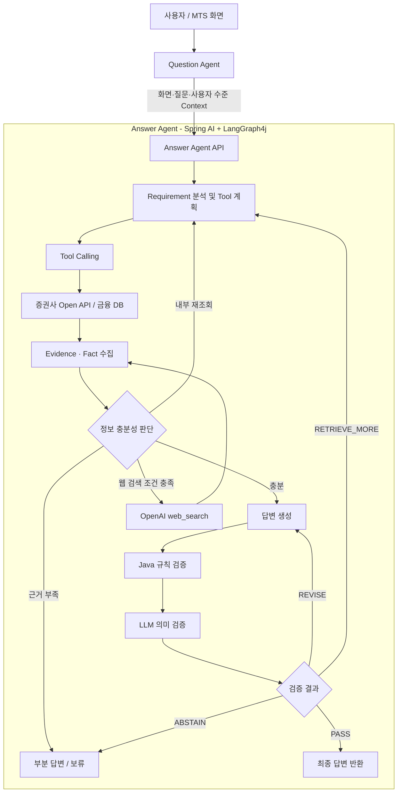

# Spring AI 기반 화면 맥락형 금융 AI 어시스턴트

> 사용자의 현재 화면과 금융 지식 수준에 맞는 질문을 선제적으로 추천하고, 금융 데이터 기반의 검증된 답변을 제공하는 Multi-Agent 서비스

## 1. 프로젝트 소개

### 개발 배경

최근 금융 앱에는 AI 종목 분석, 뉴스 요약, 투자정보 추천 등 다양한 AI 기능이 도입되고 있습니다. 하지만 대부분 사용자가 직접 AI 기능을 찾아 실행하거나 질문을 입력해야 하는 구조입니다.

특히 **금융 지식이 부족한 사용자는 현재 보고 있는 정보에서 무엇을 확인해야 하는지, 어떤 질문을 해야 하는지조차 판단하기 어렵습니다.**

이러한 문제를 해결하기 위해 사용자가 보고 있는 화면과 금융 지식 수준을 기반으로 **질문을 먼저 제안하고, 해당 질문에 필요한 금융 데이터를 조회해 맞춤형 답변을 제공하는 AI 어시스턴트**를 개발했습니다.

### 핵심 목표

- **AI 접근성 향상:** 사용자가 직접 질문을 고민하거나 AI 기능을 찾아야 하는 과정 최소화
- **맥락 기반 개인화:** 현재 조회 중인 화면과 금융 지식 수준을 반영한 질문·답변 제공
- **데이터 기반 답변:** 증권사 Open API 및 금융 DB를 활용한 근거 중심 답변 생성
- **답변 신뢰성 확보:** 규칙 기반 검증과 LLM 의미 검증을 결합하여 금융정보의 정확성 및 적절성 검증
- **안정적인 Agent 실행:** 데이터 부족·검증 실패 상황에서 재조회, 재생성, 답변 보류 등의 처리 흐름 제공

---

## 2. 핵심 기능

### ① 화면 맥락 기반 질문 추천 — Question Agent

- 사용자가 현재 조회 중인 금융 화면의 맥락 활용
- 화면에서 궁금해할 만한 금융 질문 선제적 추천
- 사용자의 금융 지식 수준을 고려한 질문 생성
- 추천 질문과 관련 Context를 Answer Agent로 전달

### ② 금융 데이터 기반 맞춤형 답변 — Answer Agent

- Question Agent로부터 화면 정보·추천 질문·사용자 수준 전달
- Spring AI Tool Calling을 활용한 금융 데이터 조회
- 질문에 필요한 근거와 수치의 충분성 판단
- 내부 데이터가 부족한 경우 재조회 및 조건부 웹 검색
- 수집된 근거를 바탕으로 사용자 수준에 맞는 답변 생성

### ③ 답변 적절성 검증 — Hybrid Validation

- **규칙 기반 검증:** 수치·단위·기간·출처·계산 결과의 정합성 확인
- **LLM 의미 검증:** 질문 적합성, 근거 타당성, 과도한 해석 여부 평가
- **조건부 후속 처리:** 검증 결과에 따라 답변 수정·추가 조회·답변 보류

| 질문 추천 | AI 답변 생성 |
|:---:|:---:|
|  |  |
| 화면 맥락 기반 맞춤형 질문 추천 | 금융 데이터 기반 답변 생성 |

---

## 3. 시스템 아키텍처

*핵심 처리 흐름을 단순화한 다이어그램이며, 실제 실행에는 검증 결과, 재시도 횟수, 시간 예산에 따른 추가 분기가 적용됩니다.*

---

## 4. Answer Agent 상세 구현

### 4.1 Spring AI 기반 Tool Calling

**문제**

금융 질문은 종목 정보, 뉴스, 공시, 금융용어 등 질문 유형에 따라 필요한 데이터 소스가 다릅니다. 또한 LLM의 자체 지식만으로 답변하면 오래되거나 부정확한 금융정보가 포함될 가능성이 있습니다.

**구현**

Spring AI를 활용해 금융 데이터 조회 Tool을 구성하고, 각 Tool의 Description에 용도와 선택 기준을 정의했습니다.

| 데이터 소스        | 역할             |
| ------------- | -------------- |
| 증권사 Open API  | 종목 및 시장 데이터 조회 |
| 뉴스 DB         | 금융 뉴스 정보 조회    |
| 공시 DB (MySQL) | 기업 공시 정보 조회    |
| 금융용어 DB       | 금융 개념 및 용어 조회  |

- 질문을 필요한 정보 단위(Requirement)로 분해
- Tool Description을 기반으로 적합한 데이터 소스 선택
- 조회 결과를 Evidence(근거)와 Fact(구조화된 수치)로 관리
- 필요한 정보가 충분하지 않으면 추가 조회 여부 판단

**내부 조회가 불충분한 경우**

내부 Tool 재조회를 우선 수행하고, 이후에도 부족한 정보 중 허용된 항목에 대해서만 OpenAI Responses API의 `web_search`를 호출하도록 구성했습니다.

웹 검색은 초기 Tool 선택 대상에서 제외했으며, 실시간 시세 조회 실패를 웹 검색으로 대체하지 않습니다.

### 4.2 Evidence 기반 답변 검증

**문제**

금융 답변은 잘못된 수치뿐 아니라 존재하지 않는 인용, 데이터 시점 불일치, 근거 없는 인과관계 설명 등이 발생할 수 있습니다.

이를 방지하기 위해 **Java 규칙 검증과 LLM 의미 검증을 결합한 Hybrid Validation 구조**를 구현했습니다.

**① RuleValidator — 규칙 기반 검증**

조회 결과를 Evidence와 Fact로 관리하고, 생성된 답변의 각 Claim(주장)을 근거 ID와 연결하여 검증합니다.

- 존재하지 않는 근거 ID 및 가짜 인용 검사
- 근거에 없는 숫자, 단위·기간 불일치 검사
- 다른 종목 정보 혼용 및 오래된 자료 검사
- 계산형 답변의 입력값과 계산 결과 검증

예를 들어 조회된 가격이 100인데 답변에 120이라고 작성했다면 수치 정합성 검사에서 오류를 탐지합니다.

**② LLM Verifier — 의미 기반 검증**

답변 생성과 분리된 LLM 호출을 통해 의미적 적절성을 평가합니다.

- 질문에 적절히 답변했는지
- 인용 근거가 실제 주장을 뒷받침하는지
- 근거 없는 인과관계를 단정하지 않는지
- 중요한 불확실성이나 한계를 누락하지 않았는지

예를 들어 주가가 상승했다는 사실만으로 특정 뉴스가 상승 원인이라고 단정하는 답변은 의미 검증 대상이 됩니다.

검증 모델은 `VERIFIER_MODEL`로 별도 지정할 수 있으며, 미지정 시 답변 생성 모델을 사용합니다.

### 4.3 LangGraph4j 기반 조건부 워크플로

**문제**

금융 답변에 오류가 있거나 조회 근거가 부족할 때 단순히 답변을 반환하거나 무제한으로 재시도하면 신뢰성과 응답속도가 저하될 수 있습니다.

**구현**

LangGraph4j를 활용해 답변 검증 결과에 따라 다음 작업을 결정하는 상태 기반 워크플로를 구성했습니다.

| 검증 결과             | 처리 방식                    |
| ----------------- | ------------------------ |
| **PASS**          | 검증된 답변 최종 반환             |
| **REVISE**        | 오류 피드백을 반영하여 답변 수정 후 재검증 |
| **RETRIEVE_MORE** | 부족한 근거를 추가 조회한 뒤 재생성·재검증 |
| **ABSTAIN**       | 답변 확정을 보류                |

**안정성 확보를 위한 처리**

- 답변 수정 및 추가 조회의 합산 재시도 기본 최대 2회
- 내부 조회 계획 수정 기본 최대 1회
- LLM이 PASS를 반환해도 규칙 검증 ERROR가 있으면 통과 불가
- 최종 후보 답변이 실제 검증된 버전인지 확인
- 검증 LLM 호출 실패 시 미검증 초안 반환 방지
- 웹 검색 호출 횟수 및 남은 요청시간을 고려한 실행 제한

이를 통해 검증 실패 시 무조건 재시도하는 것이 아니라, **오류 유형과 실행 조건에 따라 후속 작업을 제어**하도록 구현했습니다.

### 4.4 Multi-Agent 간 Context 연계

**문제**

Question Agent에서 추천된 질문만 Answer Agent에 전달하면 사용자가 어떤 금융 화면을 보고 있으며, 어느 정도의 금융 지식을 가지고 있는지 파악하기 어렵습니다.

**구현**

Question Agent와 Answer Agent를 별도 서비스로 구성하고, API 통신을 통해 다음 Context를 전달하도록 연결했습니다.

| Context          | 내용                     |
| ---------------- | ---------------------- |
| Screen Context   | 사용자가 조회 중인 금융 화면 정보    |
| Question Context | Question Agent가 추천한 질문 |
| User Context     | 사용자의 금융 지식 수준          |

Answer Agent는 전달받은 Context를 바탕으로 금융 데이터를 조회하고, 답변 생성 과정에 사용자 맥락을 반영합니다.

---

## 5. 담당 역할 및 기술 스택

### 담당 역할

**Answer Agent 개발 및 Multi-Agent 연계 담당**

- Spring AI 기반 Answer Agent 설계 및 구현
- 금융 데이터 조회 Tool 구성 및 Tool Calling 연동
- Evidence·Fact 기반 근거 관리 및 Java 규칙 검증
- LLM 기반 의미 검증 및 LangGraph4j 워크플로 구현
- Question–Answer Agent 간 Context 전달 및 API 연계
- 재조회, 재생성, 조건부 웹 검색, 답변 보류 처리

### 기술 스택

| 구분                 | 기술                        |
| ------------------ | ------------------------- |
| Language / Backend | Java, Spring 기반 백엔드       |
| AI Framework       | Spring AI                 |
| Agent Workflow     | LangGraph4j               |
| LLM / Web Search   | OpenAI API, Responses API |
| Database           | MySQL, 금융 데이터 DB          |
| External API       | 증권사 Open API              |
| Integration        | 서비스 간 HTTP API            |

---

## 6. 향후 개선 방향

### 6.1 Agent 응답속도 최적화

**목표:** 답변 검증 수준을 유지하면서 사용자의 대기시간 단축

**① 단계별 응답시간 분석**

- Micrometer 기반 LLM 호출 및 Tool 실행시간 측정
- Tool 선택 → 데이터 조회 → 답변 생성 → 검증 단계별 지연시간 분석
- 평균 및 P95 응답시간을 기준으로 병목 구간 파악

**② Tool Routing 및 데이터 조회 개선**

- 화면 맥락과 질문 유형을 활용한 Tool 후보 축소
- 독립적인 금융 데이터 조회의 병렬 처리 검토
- 금융용어 등 변경이 적은 데이터 캐싱
- 시세·뉴스 등 최신성이 중요한 데이터의 별도 캐시 갱신 정책 적용

**③ LLM 호출 및 검증 최적화**

- 불필요한 Context와 Tool 응답 데이터 축소로 토큰 사용량 절감
- 명백한 규칙 오류는 LLM 의미 검증 이전에 수정하도록 분기하는 방안 검토
- 검증 정확도를 유지하면서 중복 호출과 재시도 비용 감소

### 6.2 답변 정확도 및 신뢰성 강화

**① 실제 LLM 기반 평가 체계 구축**

- 종목·뉴스·공시·금융용어별 평가 질문 데이터셋 구성
- Tool 선택 정확도 및 근거 일치율 측정
- 검증 실패 유형과 재시도 성공률 분석
- 잘못된 근거의 답변 통과 여부를 확인하는 회귀 테스트 수행

**② Human-in-the-Loop 도입**

- 반복 검증 실패, 근거 부족 등 추가 검토가 필요한 답변 선별
- 검토 대상 답변에 대해 사람이 근거와 답변 내용을 확인하는 프로세스 설계
- 일반적인 실시간 답변은 자동 검증을 유지하고, 검토가 필요한 요청을 분리하여 응답 지연 최소화

**③ 웹 검색 근거 검증 강화**

- 현재 검색 요약·인용 중심의 수집 방식 개선
- 원문 조회 및 출처·시점 확인 절차 추가
- 충분한 근거를 확보하지 못한 경우 부분 답변 또는 답변 보류 정책 유지

### 6.3 성능 측정 지표

| 지표            | 측정 목적                |
| ------------- | -------------------- |
| 평균 / P95 응답시간 | 응답 지연 및 병목 분석        |
| Tool 선택 정확도   | 질문에 적합한 데이터 소스 선택 여부 |
| 답변 근거 일치율     | 생성된 답변과 조회 데이터의 정합성  |
| 검증 통과율        | 생성 답변의 검증 결과 분석      |
| 재시도 발생률       | 추가 조회 및 수정 빈도        |
| Fallback 호출률  | 내부 데이터만으로 답변하지 못한 비율 |
| 토큰 사용량        | LLM 호출 비용 및 효율 분석    |

**최종 목표:** 응답속도 개선 전후의 성능을 정량적으로 비교하고, 정확도와 검증 품질이 유지되는지 함께 확인하여 금융 AI Agent의 응답 효율성과 신뢰성을 개선하는 것입니다.

---

## 7. 핵심 구현 파일

| 파일                                   | 역할                       |
| ------------------------------------ | ------------------------ |
| `AnswerGraph.java`                   | Agent 실행 흐름 및 조건부 재시도 분기 |
| `RuleValidator.java`                 | 규칙 기반 근거·수치 검증           |
| `SpringAiAgentLlm.java`              | 답변 생성 및 LLM 의미 검증        |
| `AgentConfiguration.java`            | LLM 모델 설정                |
| `OpenAiWebEvidenceSearchClient.java` | OpenAI 웹 검색 연동           |
| `docs/question-coverage.md`          | 질문 평가 및 테스트 범위           |

